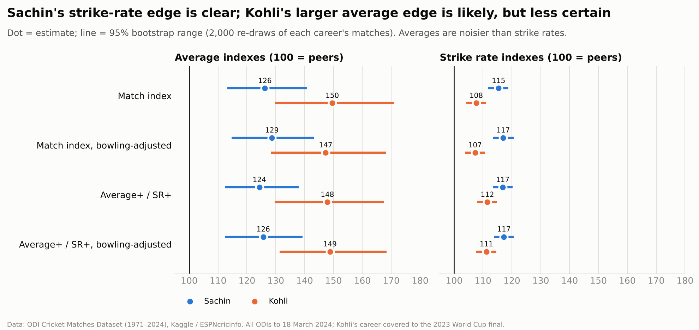
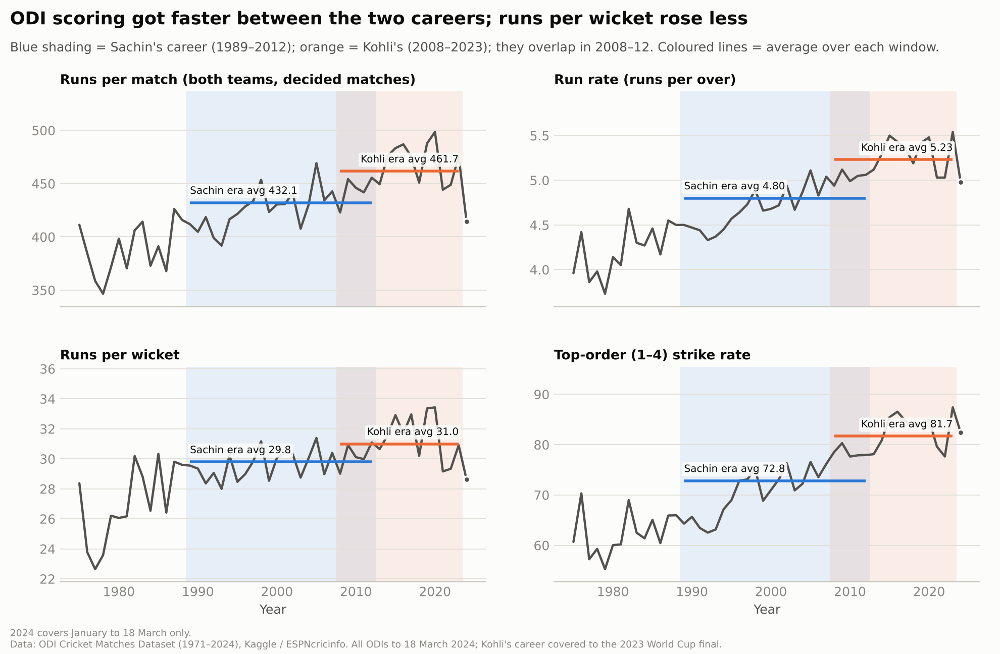
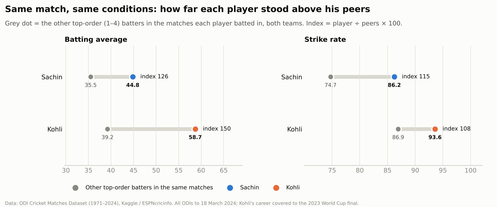
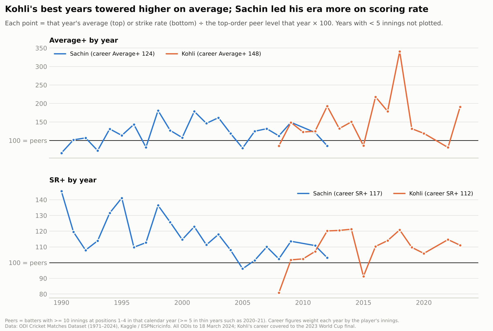
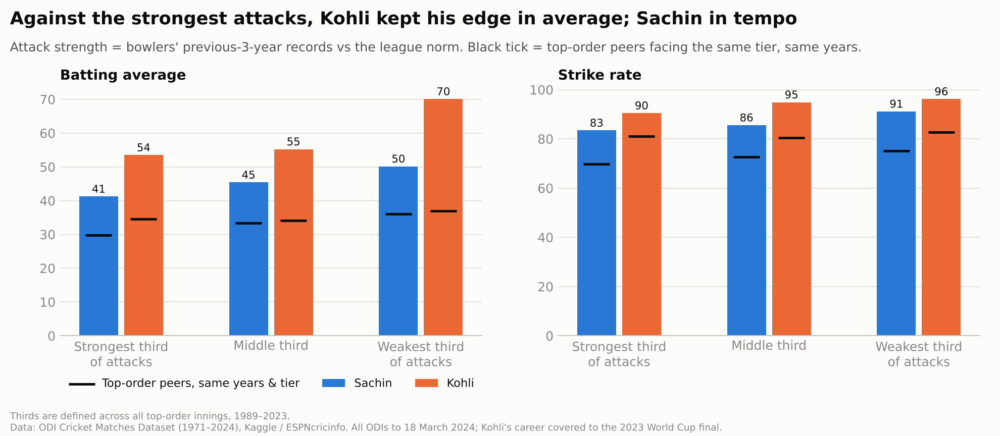
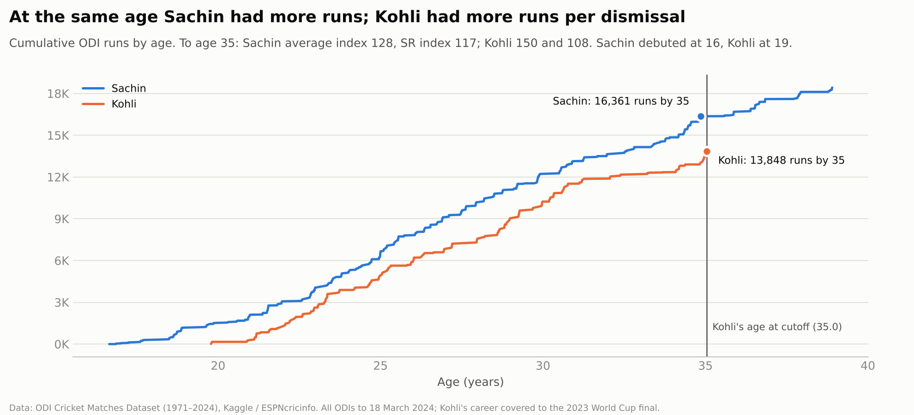
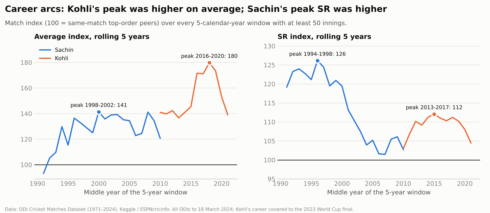
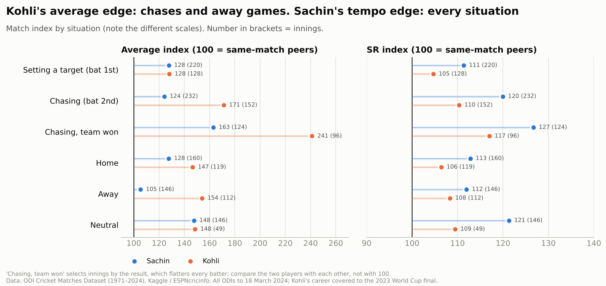
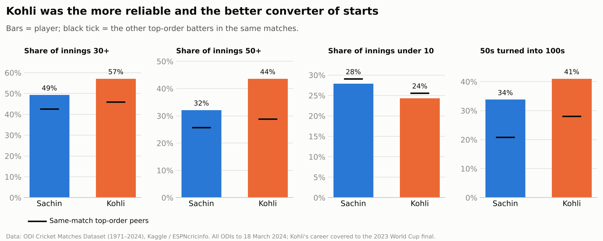
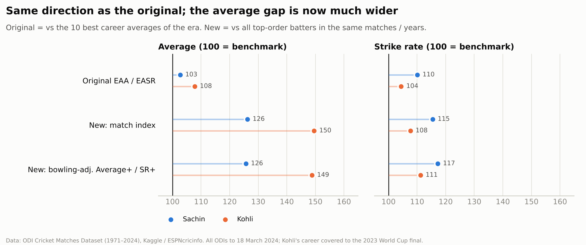

# Sachin vs Kohli: Who Was More Dominant in Their Era?

An era-adjusted comparison of Sachin Tendulkar and Virat Kohli in One-Day Internationals. It asks a narrower and fairer question than "who was better": **how far did each player stand above the batters around him, in the conditions he actually played in?**

This is a rebuild of my MS Data Analysis final project ([report](report/Final_Project_Report.pdf), [proposal](report/Project_Proposal.pdf)). The research question is the same. The methods are stronger, every number is reproducible from the raw data, and some of the answers changed.

> **Data cutoff: 18 March 2024.** The dataset covers every ODI from January 1971 to 18 March 2024. Sachin's career (1989–2012) is complete. **Kohli's career is covered up to and including the 2023 World Cup final (19 November 2023)**; his later ODIs are not included.

---

## Key findings

Match-adjusted index, where 100 = the other top-order batters in the same matches (95% range in brackets):

| | Sachin | Kohli |
|---|---|---|
| **Accumulating** (average index) | 126 (113–141) | **150** (130–171) |
| **Scoring fast** (strike-rate index) | **115** (112–119) | 108 (104–111) |

- **Kohli was the more dominant accumulator.** He comes out ahead in 97–98% of re-drawn careers: very likely a real gap, though its size is uncertain.
- **Sachin was the more dominant fast scorer.** He comes out ahead in 99–100% of re-drawn careers, and in every situation tested.
- **Both results hold in all 10 robustness checks**, including after adjusting for the strength of bowling attacks faced.
- **These are per-innings quality measures.** They don't capture Sachin's longevity and volume (a 23-year career, 18,426 runs), which is a big part of his case.



Full results are in [Findings](#findings); how to interpret the numbers is in [How to read these indexes](#how-to-read-these-indexes).

---

## The code

The pipeline runs in nine stages. Each one is a single file and each answers one question.

| Stage | What it does |
|---|---|
| [`src/01_load_validate.py`](src/01_load_validate.py) | Loads and joins the four files, derives batting positions, and checks Sachin's totals against his official record |
| [`src/02_era_context.py`](src/02_era_context.py) | How much easier did scoring get between the two careers? |
| [`src/03_match_index.py`](src/03_match_index.py) | Each player vs the other top-order batters **in the same matches** |
| [`src/04_yearly_plus.py`](src/04_yearly_plus.py) | Average+ and SR+: each player vs top-order peers **in the same years** |
| [`src/05_opposition.py`](src/05_opposition.py) | Rates every bowling attack and adjusts runs for the strength of attack faced |
| [`src/06_bootstrap.py`](src/06_bootstrap.py) | 95% confidence ranges: is each gap real or luck? |
| [`src/07_extra_lenses.py`](src/07_extra_lenses.py) | Same age, best 5-year peak, chasing vs setting, home vs away, conversion, consistency |
| [`src/08_old_vs_new.py`](src/08_old_vs_new.py) | The original EAA/EASR next to the new indexes, plus the original method re-run on this data |
| [`src/09_summary.py`](src/09_summary.py) | Headline table, robustness check and verdict ([`outputs/summary.md`](outputs/summary.md)) |

[`src/run_all.py`](src/run_all.py) runs all nine in order. Shared definitions (what counts as a peer, how an index is calculated, chart styling) live in one place, [`src/common.py`](src/common.py). The data files are documented in [`data/README.md`](data/README.md).

---

## The question

Sachin Tendulkar (ODIs 1989–2012) and Virat Kohli (2008–present) are the two most prolific ODI batters India has produced. Their careers overlapped for less than four years (August 2008 to March 2012), so for the most part they played in different conditions. The question is:

**Who was more dominant in ODIs relative to his own era?**

"Dominant" here means two separate things, because they are separate skills:

1. **Accumulating:** how many runs a player scores before getting out (batting average).
2. **Scoring fast:** how quickly he scores them (strike rate, runs per 100 balls).

---

## Why raw stats mislead

On raw numbers this looks settled. Kohli averages 58.7 to Sachin's 44.8, and strikes at 93.6 to Sachin's 86.2.

But the game Kohli played was easier to score in. Comparing the two career windows across every ODI in the dataset:

| Across all ODIs | Sachin's era (1989–2012) | Kohli's era (2008–2023) | Change |
|---|---|---|---|
| Runs per match (both teams) | 432 | 462 | +7% |
| Run rate (runs per over) | 4.80 | 5.23 | +9% |
| Runs per wicket | 29.8 | 31.0 | +4% |
| Top-order (1–4) batting average | 33.2 | 35.6 | +7% |
| Top-order (1–4) strike rate | 72.8 | 81.7 | **+12%** |



Two things follow. First, a raw comparison flatters Kohli. Second, the inflation is not uniform: **strike rates rose about three times as much as runs per wicket**. Scaling both of Sachin's numbers by one "era multiplier", as my original report did, would over-correct his average and under-correct his strike rate.

The fix is to never compare Sachin with Kohli directly. Instead, compare each one with the batters around him, and then compare the two margins.

---

## Data

**ODI Cricket Matches Dataset (1971–2024) by Bhuvanesh Prasad, Kaggle, Apache 2.0 licence, originally sourced from ESPNcricinfo.**
<https://www.kaggle.com/datasets/bhuvaneshprasad/odi-matches-historical-data-since-1971>

The four files are redistributed unchanged in [`data/`](data) under the Apache License 2.0 (copy included). No other data is used.

| File | What it holds |
|---|---|
| `odi_Batting_Card.csv` | Every batting innings, 1971 to March 2024. Row order within each innings is the batting order. |
| `odi_Matches_Data.csv` | 4,745 matches: dates, teams, venue country, result |
| `odi_Bowling_Card.csv` | Every bowler's figures in every innings |
| `players_info.csv` | Player IDs, names, dates of birth |

**Validation before analysis.** The pipeline stops with an error unless Sachin's totals match his official ODI record. They match exactly: **452 innings, 18,426 runs, average 44.83, strike rate 86.23.** Kohli's totals in this dataset are 280 innings, 13,848 runs, average 58.68, strike rate 93.59, which are his official figures after the 2023 World Cup final. "Did not bat" rows are excluded from every batting statistic.

---

## Method

```
raw batting, bowling and match files
      ↓
validate                   do Sachin's totals match his official record?
      ↓
era context                how much did scoring inflate between the careers?
      ↓
match index                player vs the other top-order batters
                           in the SAME matches
      ↓
Average+ / SR+             player vs top-order peers in the SAME years
      ↓
bowling adjustment         credit runs against strong attacks,
                           discount runs against weak ones
      ↓
bootstrap                  how much could each number move by luck alone?
      ↓
extra lenses + verdict
```

### 1. Match-adjusted index (the headline method)

For every match Sachin or Kohli batted in, the comparison group is **every other batter at positions 1–4 in that same match, from both teams**. Same ground, same pitch, same weather, same ball, same era. Across a career:

- **Average index** = player's batting average ÷ peers' batting average in those matches × 100
- **SR index** = player's strike rate ÷ peers' strike rate in those matches × 100

*Why the top order?* Openers and No. 3–4 batters have time to build an innings. Comparing them with tail-enders or late-overs hitters would mix different jobs. Sachin batted in the top four in 408 of his 452 innings, Kohli in 268 of his 280.

*Why the same match?* It controls for the era, the conditions, the venue and the quality of both teams at once, without me having to model any of them.

### 2. Average+ and SR+ (the yearly cross-check)

The same idea, but the comparison group is the whole year. For each calendar year, the peer level is the pooled average and strike rate of every top-order innings by batters with at least 10 top-order innings that year. In thin years such as 2020–21, when fewer than 20 batters qualify, the bar drops to 5 innings. A player's benchmark is those yearly peer levels, weighted by how many innings he played in each year. This is the same logic as OPS+ in baseball.

### 3. Adjusting for the bowling attack

Before every match, each bowler gets a rating from his record over the **previous three years only**: his bowling average (runs per wicket) and economy (runs per ball). Two safeguards:

- **Only spells against Full Member batting line-ups count** towards a rating. Otherwise an Associate bowler with a strong record built against other Associates would look world class.
- **Bowlers with little history are pulled towards the league norm.** In practice a rating behaves as if the bowler had an extra 50 overs and 10 wickets at league-average levels. A debutant counts as average, not as elite or terrible.

An attack's strength in an innings is its bowlers' ratings weighted by balls bowled, relative to the league norm for the same period. Runs scored against an attack that typically concedes 10% more per wicket are then divided by 1.10, and so on. Strike rate uses the economy rating. This is applied to the player **and** to every peer, and Average+/SR+ and the match index are then recalculated.

The resulting ranking looks right: Australia, South Africa, Afghanistan and Pakistan come out as the strongest attacks since 1989; Zimbabwe, Kenya and Bermuda the weakest.

### 4. Bootstrap confidence ranges

A career is a sample. Different luck in a dozen innings would have produced a different average. To measure that, each player's matches are re-drawn at random, with replacement, 2,000 times, and every index is recalculated each time (the same-match peers travel with each match). The middle 95% of those re-draws is the **95% range**. The share of re-draws in which Kohli comes out ahead is reported directly.

### 5. Robustness checks

All headline results are recalculated: using team-mates only as peers, using the opposition top order only, using Full Member matches only, and with and without the bowling adjustment. Ten variants in total, all in [`outputs/tables/09_robustness.csv`](outputs/tables/09_robustness.csv).

---

## How to read these indexes

If you only read one section, read this one.

- **100 means "exactly as good as a typical top-order batter in the same matches (or the same year)".** It is not "average cricketer"; it is a demanding bar made up of specialist openers and No. 3–4 batters.
- **Above 100 is better, and the number tells you by how much.** An average index of 150 means 50% more runs per dismissal than the top-order batters around him. Kohli's 150 is literally this: in the matches he played, he averaged 58.7 while the other top-order batters averaged 39.2.
- **The average index is about not getting out.** It rewards accumulating: building long innings and making big scores.
- **The SR index is about tempo.** It rewards scoring faster than the batters around you. A 115 means scoring 15% more runs per ball than peers in the same games.
- **These indexes can be compared across eras**, because each player is only ever measured against his own contemporaries. That is the whole point.
- **The range in brackets is the plausible range once luck is allowed for.** If two players' ranges barely overlap, the gap is very likely real. "Chance Kohli is ahead" is the share of 2,000 re-run careers in which Kohli's index came out higher than Sachin's.
- **They measure quality per dismissal and per ball, not volume.** A player who keeps up a 125 for 23 years and one who keeps it up for 10 years get the same index. Longevity has to be judged separately (see the verdict).

---

## Findings

### Headline indexes

| Index | Measure | Sachin (95% range) | Kohli (95% range) | Kohli minus Sachin | Chance Kohli is ahead |
|---|---|---|---|---|---|
| Match index | Average | 126.2 (113.3–140.9) | **149.6** (129.8–171.0) | +23.3 (−1.5 to +48.4) | 97% |
| Match index | Strike rate | **115.4** (111.7–118.8) | 107.7 (104.2–111.1) | −7.8 (−12.8 to −2.9) | 0% |
| Bowling-adjusted Average+ / SR+ | Average | 125.7 (112.5–139.3) | **148.8** (131.3–168.4) | +23.1 (+1.2 to +45.8) | 98% |
| Bowling-adjusted Average+ / SR+ | Strike rate | **117.2** (113.7–120.6) | 111.2 (107.7–114.6) | −6.1 (−11.0 to −1.1) | 1% |

**Same match, same conditions: how far did each player stand above his peers?**



**Are the gaps real or luck?**

Sachin's strike-rate edge is clear in every version: Kohli comes out ahead in 0–1% of re-drawn careers. Kohli's average edge is larger in size but less certain, because batting averages swing a lot on a handful of big innings or not-outs. He comes out ahead in 97–98% of re-draws. The gap is very likely real, but it could plausibly be anything from close to zero to almost 50 points.


**Does it hold year by year?**

Both players were above their peers in most seasons. Kohli's best seasons (2012, 2016, 2018, 2023) went higher on average than any full season of Sachin's. Sachin's scoring rate was furthest ahead of his era in the 1990s, before the rest of the game caught up.



**Does the quality of bowling change the picture?**

Very little. Sachin faced slightly more strong attacks (43% of his innings against the strongest third, vs 40% for Kohli), and adjusting for attack strength moves every index by only one to three points. Against the strongest attacks both kept their edge over peers facing the same tier: Kohli 54 vs peers' 35 on average, Sachin 83 vs peers' 70 on strike rate.



**Robustness.** Kohli leads on the average index in **10 of 10** variants. Sachin leads on the strike-rate index in **10 of 10** variants (team-mates only, opposition only, Full Member matches only, bowling-adjusted, yearly peers).

### Extra lenses

**At the same age.** Cutting both careers at Kohli's age on the cutoff date (35):

| To age 35 | Innings | Runs | 100s | Average index | SR index |
|---|---|---|---|---|---|
| Sachin | 407 | 16,361 | 42 | 127.5 | 117.1 |
| Kohli | 280 | 13,848 | 50 | 149.6 | 107.7 |

Sachin had more runs at the same age because he debuted at 16 rather than 19. Kohli had more runs per dismissal and more hundreds. After 35, Sachin added 2,065 runs at an average index of 117.



**Best 5-year peak** (match index, at least 50 innings):

| | Best window by average index | Best window by SR index |
|---|---|---|
| Sachin | 1998–2002: average 51.9, **index 141** | 1994–1998: SR 90.7, **index 126** |
| Kohli | 2016–2020: average 76.6, **index 180** | 2013–2017: SR 96.3, **index 112** |

Kohli's 2016–2020 peak is the most dominant stretch of accumulation in this comparison by a wide margin. Sachin's mid-1990s peak is the most dominant stretch of fast scoring.



**Chasing vs setting, home vs away.**

| Match index (average / SR) | Sachin | Kohli |
|---|---|---|
| Setting a target (batting first) | 128 / 111 | 128 / 105 |
| Chasing (batting second) | 124 / 120 | **171** / 110 |
| Home | 128 / 113 | 147 / 106 |
| Away | 105 / 112 | **154** / 108 |
| Neutral venue | 148 / 121 | 148 / 109 |

Batting first, the two were level on the average index. Kohli's whole advantage comes from **chasing** and from **away** matches, where Sachin's record was close to peer level. Sachin out-paced Kohli relative to peers in every one of these situations.



**Conversion and consistency** (compared with the other top-order batters in the same matches):

| | Sachin | his peers | Kohli | his peers |
|---|---|---|---|---|
| Share of innings 30+ | 49% | 43% | **57%** | 46% |
| Share of innings 50+ | 32% | 26% | **44%** | 29% |
| Share of innings under 10 | 28% | 29% | 24% | 26% |
| 50s turned into 100s | 34% | 21% | **41%** | 28% |

Both converted starts far better than their peers. Kohli did it more often, and got to 30 and 50 more often.



### Verdict

- **Accumulating runs: Kohli, fairly confidently.** He averaged about 50% more than the top-order batters in his matches; Sachin about 26% more. Kohli comes out ahead in 97–98% of re-drawn careers, so the gap is very likely real, though its exact size is uncertain. His edge comes from chasing and from away matches, and his 2016–2020 peak has no equal in Sachin's career.
- **Scoring fast: Sachin, very confidently.** He scored 15–17% faster than his peers; Kohli 8–11%. Sachin comes out ahead in 99–100% of re-draws, and in every split. His 1994–98 strike rate of 90.7, set before T20 cricket changed batting, is higher than the typical top-order strike rate in any year since, including 2023 (87.4).
- **Overall:** relative to their eras, **Kohli was the more dominant accumulator and Sachin the more dominant aggressor**. The direction matches my original report. The new methods show Kohli's average edge is much bigger than originally estimated, and Sachin's strike-rate edge is about the same size but now firmly established.
- **What these indexes leave out: longevity and volume.** Every index here measures quality per dismissal or per ball, so it says nothing about how long a player kept it up. Sachin debuted at 16, had a 23-year career (1989–2012) and scored 18,426 runs in 452 innings, staying above his peers in most of those years. Kohli's 13,848 runs came in 280 innings over 15 years, with his career still running at the cutoff. Sustained volume is a big part of Sachin's case and sits outside these numbers.

---

## Old vs new

| Metric | Original: Sachin | Original: Kohli | New: Sachin | New: Kohli |
|---|---|---|---|---|
| Raw average | 44.83 | 58.20 | 44.83 | 58.68 |
| Raw strike rate | 86.23 | 93.50 | 86.23 | 93.59 |
| **EAA** (original) | **102.67** | **107.78** | | |
| **EASR** (original) | **110.10** | **104.40** | | |
| Original method, re-run on this data: EAA | | | 102.78 | 116.22 |
| Original method, re-run on this data: EASR | | | 111.99 | 108.96 |
| **Match index: average** | | | **126.2** | **149.6** |
| **Match index: strike rate** | | | **115.4** | **107.7** |
| **Bowling-adjusted Average+** | | | **125.7** | **148.8** |
| **Bowling-adjusted SR+** | | | **117.2** | **111.2** |



**What stayed the same.** The direction. Both the original and the rebuild say Kohli was more dominant on average and Sachin on strike rate.

**Why the new numbers are higher.** The yardstick changed. The original compared each player with **the 10 best career averages of his era**, so 100 meant "as good as the elite". The new indexes compare with **every top-order batter in the same matches or years**, so 100 means "a typical specialist top-order batter". Both players clear the new bar by more. Compare the gaps and the direction between old and new, not the levels.

**Why the average gap widened from 5 points to about 23.** Three reasons, in order of importance:

1. **The old benchmark was small and fragile.** A top-10 list moves a lot with small choices. In the original, removing one player (R.N. ten Doeschate) moved Sachin's EAA by six points. Re-running the original method on this dataset reproduces Sachin's EAA almost exactly (102.78 vs 102.67), but gives Kohli 116 rather than 108. That is purely because a slightly different set of short, high-average careers (e.g. Shubman Gill, 44 innings at 61) qualified for the top 10.
2. **The old era filter left out Kohli's closest rivals.** "Career started in 2008 or later" excluded AB de Villiers (debut 2005), MS Dhoni (2004) and Rohit Sharma (2007), while including players with short careers. It also mixed in finishers such as Michael Bevan and Lance Klusener, whose job was different.
3. **Career averages are not same-time comparisons.** The new methods compare each innings with the batters in the same match or year, which is the comparison the original report's "Future Work" section asked for.

**Why the strike-rate gap held up.** Both methods agree Sachin was further ahead of his era on pace (5.7 points originally; 6–8 points now). The new version adds the confidence range, which shows this gap is the most certain result in the project.

**The "if Sachin played in Kohli's era" multiplier.** The original scaled Sachin's average and strike rate by one factor (1.067, from match totals). The era data above shows strike rates inflated about three times as much as runs per wicket. A single factor therefore over-adjusts his average and under-adjusts his strike rate. The peer-based indexes avoid the need for any multiplier.

---

## Limitations

- **The analysis stops at 18 March 2024.** Kohli's career was still running. His numbers here are a snapshot to the 2023 World Cup final, and his career indexes will move.
- **Peers are defined by batting position, not role.** A top-order batter in 1995 often had a different brief (see off the new ball) from one in 2018 (attack the powerplay). Comparing with same-match peers handles conditions, not changes in what teams asked of their top order.
- **Not-outs and team context.** Chasing innings that end not out, and how often a batter's team left him time to bat, both affect averages. Kohli was not out in 22% of his chases (Sachin 11%), often finishing the job. That is part of his skill, but not-outs also make an average noisier.
- **"Chasing, team won" selects by outcome.** Teams win partly because their batter scored, so that split flatters every batter. It is useful for comparing the two players with each other, not with 100.
- **The bowling adjustment is coarse.** It rates whole attacks, not the specific bowlers each batter faced. Ratings are not adjusted for the batting strength those bowlers had faced, and a great batter's own past innings slightly lower his opponents' ratings. The adjustment changes results by only one to three points, so these issues are unlikely to matter much.
- **No ball-by-ball data.** Phase of the innings (powerplay vs middle overs vs death), fielding restrictions and the two-new-ball rule (from 2011) are not modelled directly. The same-match comparison absorbs them only on average.
- **Uncertainty covers luck in the player's innings, not every modelling choice.** The 95% ranges show how much a career could move by chance. They don't cover the choices made here (top four, three-year bowler window, peer thresholds). The robustness table covers those instead.

---

## What I would do differently next

**Use ball-by-ball data.** Cricsheet has ball-by-ball records for most ODIs since the mid-2000s. That would allow comparing each player with peers in the same phase of the same innings, which is a much sharper control than "same match", and would directly measure the effect of powerplay rules.

**Model the batter and the bowler together.** The bowling adjustment here treats an attack's strength as fixed and then adjusts the batter. A joint model, rating every batter and every bowler at once, would avoid the small circularity where strong batters make the bowlers they face look weaker.

**Report the longevity question separately and explicitly.** The indexes answer "how dominant per innings?". A second, clearly labelled measure such as "runs above a typical top-order batter, summed over the career" would answer "how much total value?". Sachin's case is strongest there, and it deserves its own number rather than a footnote.

---

## Running it

Requires Python 3.10 or later.

```bash
pip install -r requirements.txt
python src/run_all.py
```

Runs in about 10 seconds and writes every chart to `outputs/charts/`, every table to `outputs/tables/` and the summary to [`outputs/summary.md`](outputs/summary.md). To run a single stage, run `src/01_load_validate.py` first (it builds the clean tables), then any later stage, e.g. `python src/03_match_index.py`. Stages 06–09 also need stage 05 to have run.

---

## Repository layout

```
data/                         raw data (Kaggle, Apache 2.0) + data/README.md
  odi_Batting_Card.csv
  odi_Bowling_Card.csv
  odi_Matches_Data.csv
  players_info.csv
  LICENSE-APACHE-2.0.txt
src/                          numbered pipeline stages, run in order
  common.py                   shared settings, peer definitions, index maths, chart style
  run_all.py                  runs everything
outputs/
  charts/                     every chart in this README
  tables/                     every number in this README, as CSV
  summary.md                  headline table and verdict, generated by 09_summary.py
report/                       my original final report and proposal (PDF)
LICENSE                       MIT licence for the code
```

---

## Tools

Python for the full pipeline: `pandas` and `numpy` for data work, the bootstrap and the bowling ratings; `matplotlib` for charts. Sachin is always blue and Kohli always orange; the pair was checked for colour-blind safety and contrast.

The original project used SQL and R (`ggplot2`) in Google Colab, with help from LLMs (Gemini and ChatGPT) on code and charts, as described in the report. **This version was rebuilt with Claude Code.** I set the question, the methods to use and the checks to run, and reviewed the results. Claude Code wrote and ran the pipeline and drafted this README.

---

## Credits

Data: **ODI Cricket Matches Dataset (1971–2024) by Bhuvanesh Prasad, Kaggle, Apache 2.0 licence, originally sourced from ESPNcricinfo.** <https://www.kaggle.com/datasets/bhuvaneshprasad/odi-matches-historical-data-since-1971>. The data files in [`data/`](data) are redistributed under the Apache License 2.0; see [`data/LICENSE-APACHE-2.0.txt`](data/LICENSE-APACHE-2.0.txt).

---

## License

The code is released under the MIT License. See [LICENSE](LICENSE).

The data files in [`data/`](data) are not covered by the MIT License. They remain under the Apache License 2.0 set by the dataset's author; see [`data/LICENSE-APACHE-2.0.txt`](data/LICENSE-APACHE-2.0.txt).
